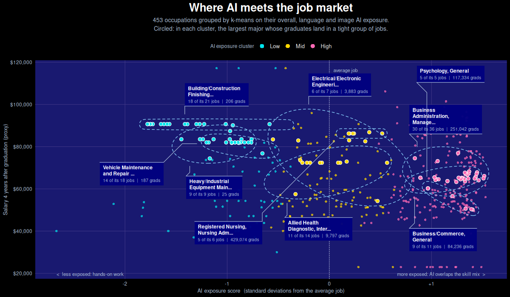
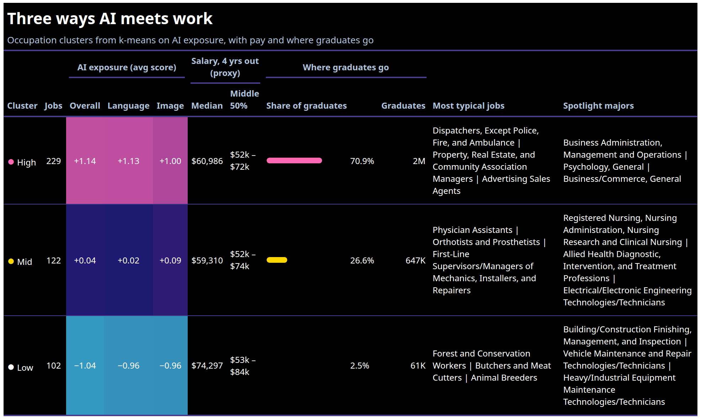

# 0. Introduction

This week's dataset asks which college majors are safest from AI, and whether the safe ones pay. It joins College Scorecard salaries, the AI Occupational Exposure (AIOE) index and a crosswalk from majors to the occupations their graduates enter.

Instead of scoring majors directly, I started from the jobs. I grouped 453 occupations into three clusters with k-means on their overall, language and image AI exposure, then asked where each major's graduates land. Everything is done in `R` with `ggplot2`, `ggforce` and `gt`.

# 1. How I Grouped the Jobs

## 1.1. Clustering Occupations by AI Exposure

Each occupation gets a salary proxy, which is the median salary four years after graduation of the majors that feed into it, weighted by their number of graduates. K-means then splits the occupations into three groups, ordered Low, Mid and High by their average exposure.

## 1.2. Picking Spotlight Majors

A major belongs to the cluster where most of its jobs sit. I kept majors with more than 75% of their jobs in that one cluster, then picked the three largest by graduates in each cluster to circle on the chart.

# 2. Plots

## 2.1. Where AI Meets the Job Market

{fig-align="center"}

[**Findings**]{.underline}:

-   **Pay overlaps:** the three clusters' pay ranges overlap a lot, so AI exposure on its own says little about salary.
-   **Low exposure:** construction finishing, vehicle maintenance and heavy-equipment work sit at the far left, with salaries around $80k–$90k.
-   **High exposure:** business administration, general psychology and general business send graduates into jobs where AI overlaps most with the skill mix.
-   **Where graduates go:** most graduates head into mid- and high-exposure jobs, as the table below also shows. High exposure doesn't mean AI will replace these jobs; it means they will change.

## 2.2. Three Ways AI Meets Work

{fig-align="center"}

[**Findings**]{.underline}:

-   **Low exposure pays best:** the 102 low-exposure jobs have the highest median salary proxy, $74,297, against about $61,000 for the high cluster and $59,000 for the mid cluster.

# 3. References

-   [College Scorecard](https://collegescorecard.ed.gov/data/) field-of-study data, U.S. Department of Education
-   [AI Occupational Exposure (AIOE) index](https://github.com/AIOE-Data/AIOE), Felten, Raj and Seamans (2021)
-   [NCES/BLS CIP-to-SOC crosswalk](https://nces.ed.gov/ipeds/cipcode/resources.aspx)
-   [ggforce `geom_mark_ellipse()`](https://ggforce.data-imaginist.com/reference/geom_mark_ellipse.html) for the circled majors
