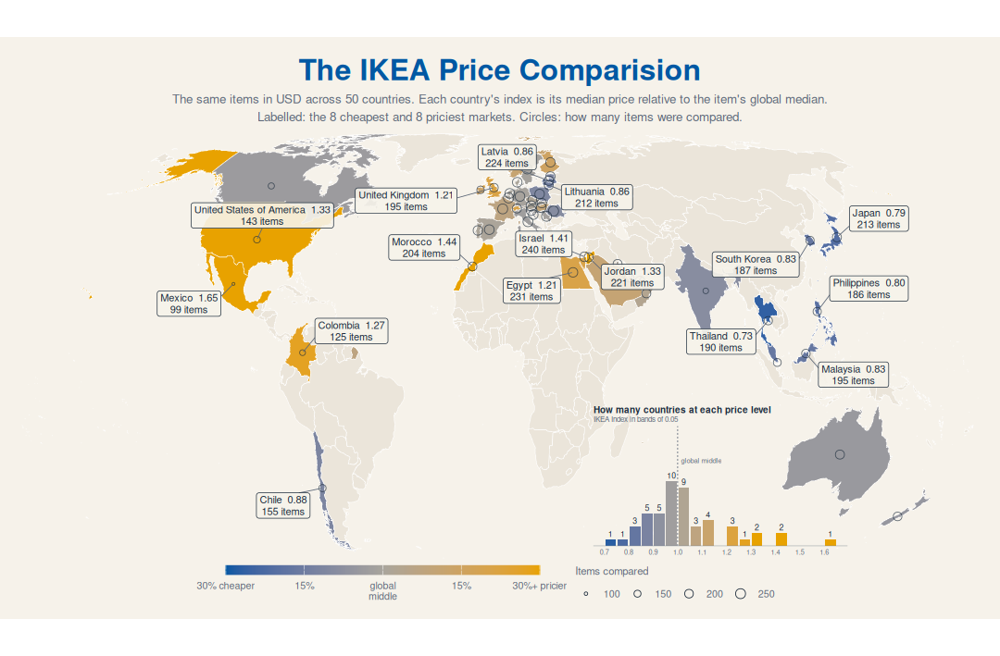
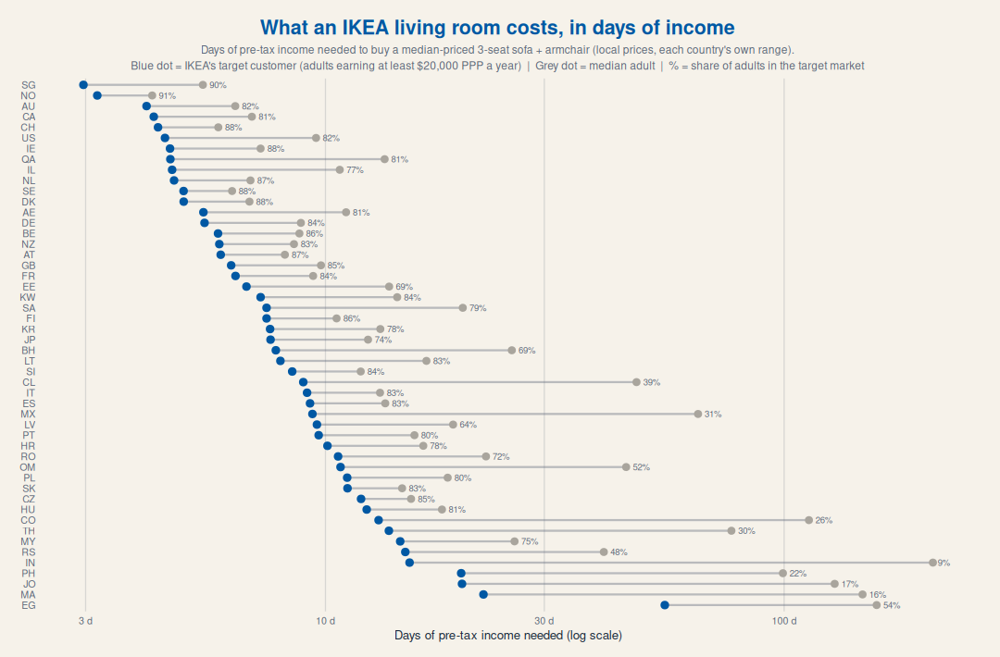
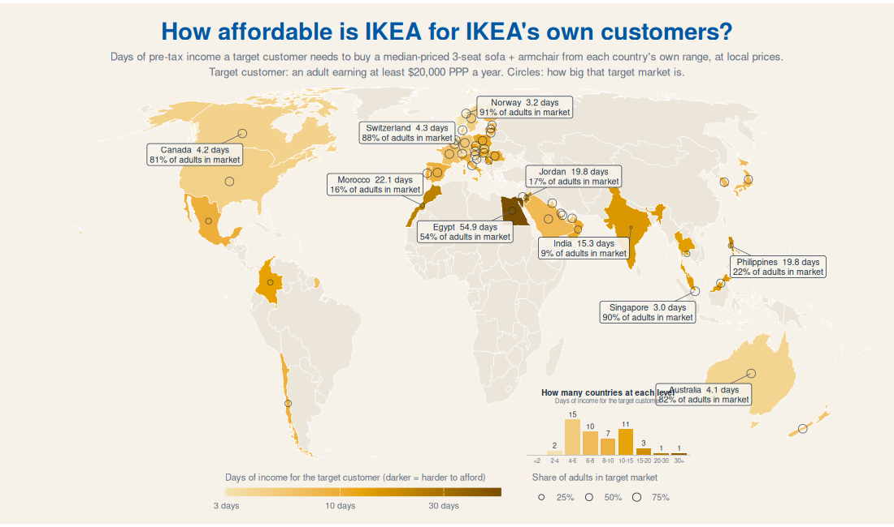

# 0. Introduction

This week's dataset is every IKEA sofa and armchair listed on ikea.com in 50 countries, with prices in local currency and in US dollars. The question I wanted to answer is simple which is where is IKEA cheap, and where is it actually affordable?

First, I compared the price of the same items across countries in US dollars. Then I priced a living room (a 3-seat sofa and an armchair) in each country's own currency, and turned that into days of income using the World Inequality Database.

# 1. How I Measured It

## 1.1. The IKEA Price Index

I kept only the items sold in at least 10 countries. For each item, I divided its price in a country by its global median price. A country's index is the median of these ratios. So 1.00 is the global middle, 0.80 means about 20% cheaper and 1.30 means 30% pricier.

## 1.2. Days of Income for a Living Room

-   **The basket:** a median-priced 3-seat sofa plus a median-priced armchair from each country's own range, in local currency, so no exchange rate is needed.
-   **Income:** average pre-tax income for each 1% slice of adults from the World Inequality Database, the latest year available for each country. Income is per adult, not per household.
-   **IKEA's target customer:** an adult earning at least 20,000 PPP dollars a year. This floor is the same standard of living everywhere and does not depend on IKEA's prices.
-   **Affordability:** the basket cost divided by one day of income, for the target customer and for the median adult.

Taxes, instalments, household size and inflation since the income year are not included.

# 2. Plots

## 2.1. The IKEA Price Comparison

{fig-align="center"}

[**Findings**]{.underline}:

-   **Most countries sit close to the middle:** 19 of the 50 countries are within 5% of the global median price.
-   **Cheapest in dollars:** Thailand (0.73), Japan (0.79), the Philippines (0.80), South Korea and Malaysia (0.83). East and Southeast Asia is where IKEA's dollar prices are lowest.
-   **Priciest in dollars:** Mexico (1.65), Morocco (1.44), Israel (1.41), the United States and Jordan (1.33). Mexico pays almost two-thirds more than the global middle for the same items.
-   **Europe is mixed:** the Baltics are cheap (Latvia and Lithuania at 0.86), while the United Kingdom is 21% above the middle.

## 2.2. What an IKEA Living Room Costs, in Days of Income

{fig-align="center"}

[**Findings**]{.underline}:

-   **For the target customer, IKEA is affordable almost everywhere:** a living room costs about 3 days of income in Singapore and Norway, and around 4 days in Australia, Canada and Switzerland.
-   **For the median adult, the gap is big:** in India the median adult needs around 200 days of income, and only 9% of adults are in IKEA's target market. Morocco (16%), Jordan (17%) and the Philippines (22%) are similar.
-   **Cheap is not the same as affordable:** Thailand has the cheapest IKEA in dollars, but only 30% of adults are in the target market and the median adult needs about 75 days of income. The United States is one of the priciest in dollars, but a living room costs its target customer under 5 days.

## 2.3. How Affordable Is IKEA for IKEA's Own Customers?

{fig-align="center"}

[**Findings**]{.underline}:

-   **Most countries are in the 4 to 15 day range:** 43 of the 50 countries fall there for the target customer.
-   **The hardest places are in North Africa and the Middle East:** Egypt (54.9 days), Morocco (22.1 days) and Jordan (19.8 days), along with the Philippines (19.8 days) and India (15.3 days).
-   It means the price tag alone doesn't tell the story. A low dollar price in a country with lower incomes can still be harder to afford than a high dollar price in a rich country.
-   **Egypt needs care:** it shows the most days of income but also 54% of adults in the target market, which doesn't fit together. The income data is older than IKEA's 2026 prices, and Egypt's currency has changed a lot since, so I would read Egypt with caution.

# 3. References

-   [IKEA sofas and armchairs dataset](https://github.com/rfordatascience/tidytuesday/blob/main/data/2026/2026-10-27/readme.md), curated by Georgios Karamanis
-   [World Inequality Database](https://wid.world/) and its [`wid` R package](https://github.com/world-inequality-database/wid-r-tool)
-   [Natural Earth](https://www.naturalearthdata.com/) country boundaries via `rnaturalearth`
-   [ggrepel](https://ggrepel.slowkow.com/) for the map labels
